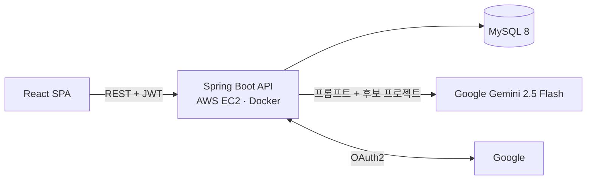
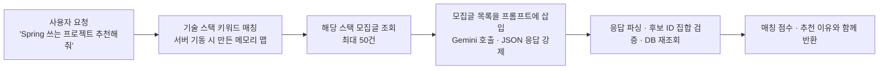
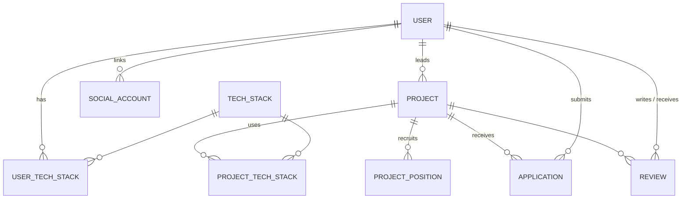

# 🚀 Team Builder — AI 추천 기반 사이드 프로젝트 팀원 매칭 플랫폼

> 모집글 작성 · 지원 · 팀원 관리 · 상호 평가까지 팀 빌딩의 전 과정을 다루고, **"Spring 쓰는 3개월짜리 프로젝트 찾아줘" 같은 자연어 요청을 Gemini AI로 분석해 프로젝트를 추천**하는 서비스


| 항목 | 내용 |
| --- | --- |
| 개발 기간 | 2026.03 ~ 2026.06 (캡스톤 디자인) |
| 개발 인원 | 4인 (백엔드 · 프론트엔드 · 인증 분담) |
| 나의 역할 | **팀장 / 백엔드 리드** — ERD · 엔티티 설계, AI 추천 엔진, Docker 인프라, 협업 프로세스 운영 |
| 협업 지표 | Pull Request **18건 전부 리뷰 후 직접 머지**, 브랜치 병합 충돌 해결 담당 |

---

## ✨ 주요 기능

| 구분 | 기능 |
| --- | --- |
| **회원** | 이메일 회원가입/로그인, **Google 소셜 로그인**, 기술 스택 · 지역 · 소개 등 프로필 관리 |
| **모집글** | 제목 · 내용 · 지역 · 기간 · 대면 여부 · 기술 스택 · **모집 포지션(역할 · 인원)**을 담은 모집글 작성/수정, 페이지네이션 조회, 내가 쓴 글 조회, 모집 상태 변경 |
| **지원** | 포지션 · 경험 · 연락처를 담은 지원서 제출, 중복 지원 차단, 팀장의 수락 / 거절(포지션 정원까지) |
| **팀 관리** | 수락된 지원자로 팀원 목록 구성, 팀원 추가 · 제외 |
| **상호 평가** | 프로젝트 종료 후 팀원끼리 별점 · 코멘트를 한 번에 저장(같은 팀원에게 한 번만), 받은 평가 조회 |
| **AI 추천** | 자연어 요청을 분석해 적합한 모집글을 매칭 점수 · 추천 이유와 함께 최대 3개 추천 |

## 🏗 아키텍처



## 🛠 기술 스택

| 구분 | 기술 |
| --- | --- |
| Backend | Java 21, Spring Boot 3.5, Spring Data JPA, Spring Security, OAuth2 Client, jjwt, Bean Validation, springdoc-openapi (Swagger) |
| Database | MySQL 8 |
| AI | Google Gemini API (gemini-2.5-flash) |
| Frontend | React 19, Vite, React Router 7, Axios |
| Infra | Docker, Docker Compose, AWS EC2 |
| Test | JUnit 5, Mockito, `@WebMvcTest`, `@SpringBootTest` + MySQL(GitHub Actions 서비스 컨테이너) |
| Collaboration | GitHub Flow (기능 브랜치 → PR → 리뷰 → 머지) |

---

## 💡 내가 주도한 핵심 구현

### 1. 자연어 기반 AI 프로젝트 추천 엔진 ([AiService](src/main/java/com/capstone/backend/service/AiService.java))

LLM에 DB 전체를 넘기면 비용과 응답 시간이 커지고, 존재하지 않는 프로젝트를 지어내는 문제가 생깁니다. 그래서 **DB에서 후보를 먼저 좁힌 뒤 그 목록 안에서만 고르게** 하는 검색 증강(RAG) 방식으로 설계했습니다.



- **키워드 → 기술 스택 매핑을 메모리에 적재** — 기술 스택 이름과 별칭 키워드를 소문자 · 공백 제거로 정규화해 불변 맵으로 올려 두고, 요청마다 DB를 조회하지 않고 가장 긴 키워드부터 매칭합니다. ("springboot", "Spring Boot" 모두 매칭, "javascript"에 "java"가 걸리지 않음) 기술 스택 초기 데이터가 들어간 뒤(`ApplicationReadyEvent`) 적재하고, 비어 있으면 첫 요청에서 다시 적재합니다. ([TS-10](docs/troubleshooting.md#ts-10-키워드-맵이-비어-버리는-초기화-순서)) 실행 중 새로 생긴 기술 스택은 저장 트랜잭션 커밋 후 이벤트로, DB 직접 수정은 10분 주기 재적재로 반영합니다. ([TS-20](docs/troubleshooting.md#ts-20-실행-중-새로-생긴-기술-스택이-키워드-맵에-없음))
- **후보 축소** — 찾은 기술 스택이 연결된 최신 모집글만 JPQL 조인으로 최대 50건 조회하고, 매칭되는 스택이 없으면 최신 모집글로 대체합니다. 본문은 300자로 잘라 프롬프트 길이를 제한해 응답 속도와 토큰 비용을 통제했습니다.
- **DB 트랜잭션과 외부 호출 분리** — 후보 조회(트랜잭션 1) → Gemini 호출(트랜잭션 없음) → 결과 재조회(트랜잭션 2)로 나누고 OSIV를 꺼, Gemini 응답(최대 15초)을 기다리는 동안 DB 커넥션을 쥐고 있지 않습니다. ([TS-12](docs/troubleshooting.md#ts-12-gemini-응답을-기다리는-동안-db-커넥션-점유))
- **구조화된 응답 강제** — Gemini의 `responseMimeType: application/json` 옵션과 응답 예시를 함께 넣어 `project_id`, `matching_score`, `reason` 형식의 JSON 배열만 받도록 했습니다.
- **LLM 응답을 신뢰하지 않는 후처리**
  - 응답에 설명 문장이 섞여도 첫 `[`부터 마지막 `]`까지만 잘라 파싱
  - AI가 돌려준 ID 중 **이번 요청의 후보였던 ID만** 남기고 DB에서 다시 조회해 반환 (환각 방지, 제목은 AI가 아닌 DB 값) ([TS-11](docs/troubleshooting.md#ts-11-ai가-후보가-아니었던-id를-돌려줘도-통과))
  - API 오류 · 파싱 실패 시 500 대신 빈 추천 목록을 반환해 화면이 깨지지 않게 처리

### 2. 팀 빌딩 도메인 ERD · 엔티티 설계



- 사용자-기술 스택, 프로젝트-기술 스택의 **N:M 관계를 연결 엔티티로 분리**해, 기술 스택 기준 검색과 AI 추천 후보 조회를 같은 구조로 처리했습니다.
- **'지원'을 독립 엔티티로 두고 상태(PENDING → ACCEPTED / REJECTED)를 관리**해, 별도 팀원 테이블 없이 수락된 지원서로 팀원 목록을 구성합니다. 상태 전이는 엔티티 메서드가 검증하고, 같은 사용자의 같은 프로젝트 중복 지원은 `UNIQUE(applicant_id, project_id)` 제약으로 DB가 최종 차단합니다. 모집 상태는 `ProjectStatus` enum 한 곳에서 정의합니다(DB에는 기존 한글 라벨 저장).
- 포지션별 모집 인원(`requiredCount` / `currentCount`)은 지원 수락 시 **조건부 UPDATE(`... WHERE current_count < required_count`)로 원자적으로 늘려** 동시에 수락해도 정원을 넘지 않게 했습니다. 영향 행이 0이면 409로 응답하고 상태 변경도 롤백합니다. ([TS-06](docs/troubleshooting.md#ts-06-포지션-정원-메서드가-호출되지-않음)) 글 수정에서 인원을 줄이거나 포지션을 지울 때도 조건부 UPDATE/DELETE(`current_count <= 새 정원`, `current_count = 0`)를 써서 동시 수락과 겹쳐도 정원을 넘지 않습니다. ([TS-19](docs/troubleshooting.md#ts-19-화면에-포지션-입력이-없어-정원-제한이-api로-만든-글에만-적용))
- 상호 평가는 `UNIQUE(reviewer_id, reviewee_id, project_id)`로 같은 프로젝트에서 같은 팀원에게 한 번만 남길 수 있고, 동시 요청의 제약 위반은 409로 바꿉니다. ([TS-16](docs/troubleshooting.md#ts-16-리뷰-중복을-조회로만-막음))
- 모든 엔티티에 JPA Auditing으로 생성 · 수정 시각을 자동 기록하고, 무분별한 수정을 막기 위해 setter 대신 의도가 드러나는 변경 메서드(`updateStatus`, `updateProfile` 등)만 열어 두었습니다.

### 3. Docker Compose 기반 실행 환경 표준화

팀원마다 OS와 로컬 MySQL 설정이 달라도 같은 환경에서 개발 · 실행할 수 있도록, MySQL · 백엔드 · 프론트엔드를 Compose 하나로 묶어 `docker compose up` 한 번으로 같은 환경을 띄우도록 초기 인프라를 구성했습니다.

- **빌드 캐시 최적화** — Gradle 설정 파일만 먼저 복사해 의존성 레이어를 분리했습니다. 소스만 바뀌면 재빌드 시 의존성 다운로드 단계를 캐시에서 재사용하고, 멀티 스테이지 빌드로 실행 이미지에는 jar만 담았습니다.
- **비밀 값 분리** — DB 비밀번호, Gemini API 키를 환경변수로 주입하고 `.env`는 커밋하지 않도록 정리했습니다.
- 이후 팀원이 MySQL `healthcheck` 기반 기동 순서 보장(`service_healthy`), `utf8mb4` · KST 시간대 설정을 더해 한글 깨짐과 DB 미기동 상태의 연결 실패를 막았습니다.

### 4. Swagger API 문서화

**springdoc(Swagger UI)** 를 도입하고 Security 접근 허용을 설정해, 프론트엔드 팀원이 백엔드 코드를 보지 않고도 엔드포인트와 요청 형식을 확인하고 바로 호출해 볼 수 있게 했습니다.

### 5. 협업 프로세스 운영 (팀장)

- 기능 단위 브랜치(`feature/*`, 팀원 이름 접두사)에서 작업하고 **PR을 통해서만 main에 병합**하는 규칙을 운영했습니다.
- 18건의 PR을 직접 리뷰 · 머지했고, `build.gradle` · `application.yml` · `User` 엔티티 · CORS 설정처럼 여러 브랜치가 동시에 수정한 파일의 **병합 충돌을 정리**했습니다.

## 🤝 팀 구성과 역할

| 팀원 | 담당 |
| --- | --- |
| **나영준 (팀장)** | 프로젝트 초기 구성, ERD · 엔티티 설계, 기술 스택 API · 초기 데이터, AI 추천 엔진, 리뷰 · 프로필 API, Swagger, Docker 인프라, PR 리뷰 · 머지 |
| zoonone | Spring Security · JWT · OAuth2 소셜 로그인, 인증 테스트 코드 |
| Muwon | 마이페이지 · 지원서 · 모집글 관리 화면, Axios 인터셉터, 프로젝트 API 연동 |
| strongshark | 메인 · 글 작성 · 상세 페이지, AI 추천 화면, 팀원 평가 화면 |

> 팀원 표기는 GitHub 계정명 기준입니다.

## 🔐 인증 · 공통 처리 (팀 구현)

- 이메일 로그인과 OAuth2 소셜 로그인 모두 **최종적으로 같은 JWT를 발급**해 이후 요청은 동일한 필터로 인증합니다.
- 제공자별 사용자 정보는 `OAuth2UserInfo` 인터페이스와 팩토리로 받습니다. 캡스톤 당시 Google · Kakao · Naver를 구현했고, 이후 운영할 키를 줄이려고 **Google만 남기고** Kakao · Naver는 제거했습니다. 다른 제공자를 다시 붙일 때는 구현체 하나와 팩토리 분기만 추가하면 됩니다. ([TS-21](docs/troubleshooting.md#ts-21-env에-넣은-oauthjwt-값이-컨테이너에-전달되지-않음))
- 소셜 로그인 시 같은 이메일의 기존 계정이 있으면 새로 만들지 않고 연동하며, 소셜 계정으로 비밀번호 로그인을 시도하면 거절합니다.
- **인가는 기본 닫힘**입니다. 모집글 · 기술 스택 조회, 로그인 · 회원가입, OAuth2, Swagger만 공개하고 나머지는 로그인이 필요합니다. 요청자는 요청 본문 · URL의 ID가 아니라 JWT에서만 꺼내고, 글 수정 · 지원 수락은 작성자만, 지원 취소는 지원자 본인만 할 수 있도록 서비스 계층에서 소유권을 검사합니다. ([TS-05](docs/troubleshooting.md#ts-05-인가-없이-배포된-api))
- `@RestControllerAdvice`로 예외를 한 곳에서 처리해 `{ "code": "NOT_FOUND", "message": "..." }` 형태로 응답을 통일했습니다. (검증 실패 400, 인증 실패 401, 권한 없음 403, 없음 404, 충돌 409, 그 외 500 고정 문구) Security 필터 단계의 401/403도 같은 형식입니다.
- 지원서 목록은 `JOIN FETCH`, 모집글 목록은 `@EntityGraph`(작성자) + `default_batch_fetch_size`(기술 스택 · 포지션)로 N+1 쿼리를 방지합니다.
- 테스트: JWT 발급/검증, 필터의 인증 컨텍스트 설정, 3개 제공자별 사용자 생성, 로그인 · 회원가입 API(`@WebMvcTest`), 인가 규칙 · 소유권 검사, 상태 전이, AI 응답 검증, 그리고 CI의 MySQL로 돌리는 통합 테스트(정원 동시 수락, 리뷰 동시 저장, 포지션 축소와 수락 동시 실행, 글 수정의 스택 · 포지션 반영, 내가 쓴 글 페이징, 키워드 맵 실행 중 갱신, 목록 쿼리 수, Gemini 대기 중 트랜잭션 미점유, 전체 팀 빌딩 흐름). CI는 테스트 수 · 실패 테스트를 PR annotation으로 보여 줍니다.

## 📂 프로젝트 구조

```
├── src/main/java/com/capstone/backend
│   ├── controller/        # Auth, User, Project, Application, Review, TechStack, AI
│   ├── service/           # 비즈니스 로직 (AiService: Gemini 추천 엔진)
│   ├── repository/        # Spring Data JPA, JPQL (JOIN FETCH, 기술 스택 조인 조회)
│   ├── entity/            # User, Project, Application, Review, TechStack 및 연결 엔티티
│   ├── dto/
│   ├── security/          # SecurityConfig, OAuth2 (Google)
│   ├── global/            # JWT, 공통 예외 처리, 더미 데이터 로더
│   └── config/            # CORS, 기술 스택 초기 데이터
├── src/test/              # 단위 · 슬라이스(@WebMvcTest) · MySQL 통합 테스트
├── frontend/              # React 클라이언트
├── Dockerfile             # 멀티 스테이지 빌드
└── docker-compose.yml     # MySQL + Backend + Frontend
```

## 🚀 실행 방법

```bash
cp .env.example .env     # DB 비밀번호, GEMINI_API_KEY 입력
docker compose up --build
```

- 프론트엔드: http://localhost:5173
- API 문서(Swagger UI): http://localhost:8080/swagger-ui/index.html
- 실행 전 `.env.example`을 `.env`로 복사해 `GOOGLE_CLIENT_ID` · `GOOGLE_CLIENT_SECRET` · `JWT_SECRET`을 채웁니다. 셋 중 하나라도 비어 있으면 `docker compose`가 기동을 거부합니다. compose는 `.env`를 컨테이너에 자동으로 넘기지 않으므로 새 값은 `docker-compose.yml`의 `backend.environment`에도 추가해야 합니다. ([TS-21](docs/troubleshooting.md#ts-21-env에-넣은-oauthjwt-값이-컨테이너에-전달되지-않음))
- compose 없이 `./gradlew bootRun`으로 띄울 때는 Spring이 `.env`를 읽지 않으므로, `application-local.yml.example`을 `application-local.yml`(커밋 제외)로 복사해 값을 넣고 `local` 프로필로 실행합니다.
- Google Cloud Console의 승인된 리디렉션 URI에 `http://localhost:8080/login/oauth2/code/google`(배포 시 백엔드 주소로)을 등록합니다. 로그인 성공 후에는 `OAUTH2_REDIRECT_URI`(기본 `http://localhost:5173/oauth/callback`)로 JWT가 전달됩니다.
- 스키마 자동 변경은 `JPA_DDL_AUTO`(기본 `update`)로 조정합니다. 운영은 스키마 확인 후 `validate`를 권장합니다. ([TS-14](docs/troubleshooting.md#ts-14-ddl-auto-update가-운영-스키마를-직접-변경-부분-해결)) `update`는 유니크 제약 추가가 실패해도 경고만 남기므로, 기존 데이터에 중복 지원 · 중복 리뷰가 없는지 먼저 확인합니다. ([TS-16](docs/troubleshooting.md#ts-16-리뷰-중복을-조회로만-막음))
- AI 키워드 맵 주기 재적재 간격은 `TECH_KEYWORDS_RELOAD_INTERVAL_MS`(기본 600000 = 10분)입니다.

## 🔭 회고와 다음 단계

> 캡스톤 이후 셀프 코드 리뷰로 찾은 문제(예외 메시지 노출, Gemini 타임아웃, 지원 상태 전이, 인가 등)와 해결 과정은 [`docs/troubleshooting.md`](docs/troubleshooting.md)에 정리했습니다. PR마다 CI(`.github/workflows/ci.yml`)가 빌드·테스트를 실행합니다.

- **스키마 마이그레이션 도구 도입** — 지금은 `ddl-auto: update`가 기동 시 스키마를 바꿉니다. 운영 스키마를 기준선으로 Flyway를 도입하고 운영은 `validate`로 바꿀 계획입니다.
- **지원서-포지션 FK** — 포지션 입력 화면과 수정 API는 들어갔지만(TS-19), 지원서와 포지션은 아직 문자열(`support_role` = `role_name`)로 연결됩니다. 데이터 이전을 포함해 `position_id` FK로 바꿀 예정입니다.
- **기술 스택 ID 하드코딩 제거** — 글 작성 화면의 기술 스택 목록이 초기 데이터 삽입 순서(ID 1~43)에 기대고 있어 `GET /api/tech-stacks`를 쓰도록 바꿀 예정입니다.
- **AI 추천 품질 측정** — 추천 결과에 대한 사용자 반응을 기록해 키워드 매핑과 프롬프트를 개선하는 근거로 삼을 예정입니다.
