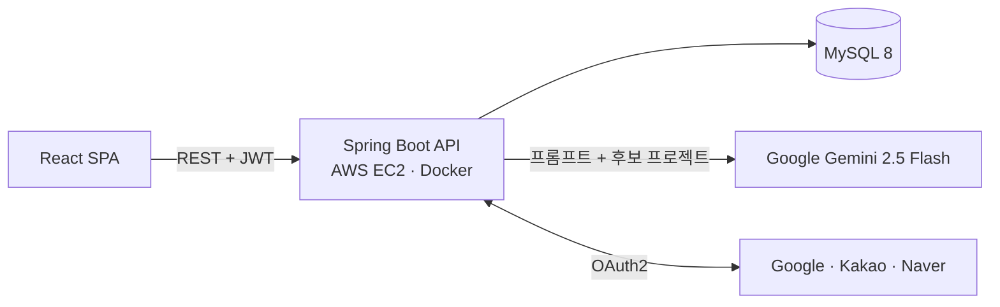
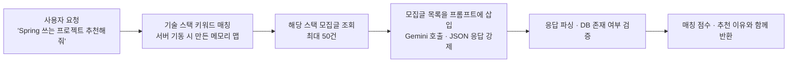
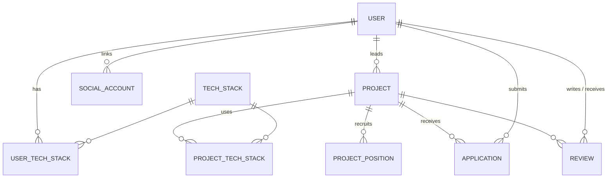

# 🚀 Team Builder — AI 추천 기반 사이드 프로젝트 팀원 매칭 플랫폼

> 모집글 작성 · 지원 · 팀원 관리 · 상호 평가까지 팀 빌딩의 전 과정을 다루고, **"Spring 쓰는 3개월짜리 프로젝트 찾아줘" 같은 자연어 요청을 Gemini AI로 분석해 프로젝트를 추천**하는 서비스


| 항목 | 내용 |
| --- | --- |
| 개발 기간 | 2026.03 ~ 2026.06 (캡스톤 디자인) |
| 개발 인원 | 5인 (백엔드 · 프론트엔드 · 인증 분담) |
| 나의 역할 | **팀장 / 백엔드 리드** — ERD · 엔티티 설계, AI 추천 엔진, Docker 인프라, 협업 프로세스 운영 |
| 협업 지표 | Pull Request **18건 전부 리뷰 후 직접 머지**, 브랜치 병합 충돌 해결 담당 |

---

## ✨ 주요 기능

| 구분 | 기능 |
| --- | --- |
| **회원** | 이메일 회원가입/로그인, **Google · Kakao · Naver 소셜 로그인**, 기술 스택 · 지역 · 소개 등 프로필 관리 |
| **모집글** | 제목 · 내용 · 지역 · 기간 · 대면 여부 · 기술 스택을 담은 모집글 작성/수정, 페이지네이션 조회, 모집 상태 변경 |
| **지원** | 지원 포지션 · 경험 · 연락처를 담은 지원서 제출, 중복 지원 차단, 팀장의 수락 / 거절 |
| **팀 관리** | 수락된 지원자로 팀원 목록 구성, 팀원 추가 · 제외 |
| **상호 평가** | 프로젝트 종료 후 팀원끼리 별점 · 코멘트를 한 번에 저장, 받은 평가 조회 |
| **AI 추천** | 자연어 요청을 분석해 적합한 모집글을 매칭 점수 · 추천 이유와 함께 최대 3개 추천 |

## 🏗 아키텍처



## 🛠 기술 스택

| 구분 | 기술 |
| --- | --- |
| Backend | Java 21, Spring Boot 3.5, Spring Data JPA, Spring Security, OAuth2 Client, jjwt, Bean Validation, springdoc-openapi (Swagger) |
| Database | MySQL 8 |
| AI | Google Gemini API (gemini-2.5-flash) |
| Frontend | React 19, Vite, React Router 7, Axios |
| Infra | Docker, Docker Compose, AWS EC2 |
| Test | JUnit 5, Mockito, `@WebMvcTest` |
| Collaboration | GitHub Flow (기능 브랜치 → PR → 리뷰 → 머지) |

---

## 💡 내가 주도한 핵심 구현

### 1. 자연어 기반 AI 프로젝트 추천 엔진 ([AiService](src/main/java/com/capstone/backend/service/AiService.java))

LLM에 DB 전체를 넘기면 비용과 응답 시간이 커지고, 존재하지 않는 프로젝트를 지어내는 문제가 생깁니다. 그래서 **DB에서 후보를 먼저 좁힌 뒤 그 목록 안에서만 고르게** 하는 검색 증강(RAG) 방식으로 설계했습니다.



- **키워드 → 기술 스택 매핑을 서버 기동 시 메모리에 적재** — 기술 스택 이름과 별칭 키워드를 소문자 · 공백 제거로 정규화해 `ConcurrentHashMap`에 올려 두고, 요청마다 DB를 조회하지 않고 스택을 찾습니다. ("springboot", "Spring Boot" 모두 매칭)
- **후보 축소** — 찾은 기술 스택이 연결된 모집글만 JPQL 조인으로 최대 50건 조회하고, 매칭되는 스택이 없으면 최신 모집글로 대체합니다. 프롬프트 길이를 제한해 응답 속도와 토큰 비용을 통제했습니다.
- **구조화된 응답 강제** — Gemini의 `responseMimeType: application/json` 옵션과 응답 예시를 함께 넣어 `project_id`, `matching_score`, `reason` 형식의 JSON 배열만 받도록 했습니다.
- **LLM 응답을 신뢰하지 않는 후처리**
  - 응답에 설명 문장이 섞여도 첫 `[`부터 마지막 `]`까지만 잘라 파싱
  - AI가 돌려준 ID를 DB에서 다시 조회해 **실제로 존재하는 프로젝트만** 반환 (환각 방지)
  - API 오류 · 파싱 실패 시 500 대신 빈 추천 목록을 반환해 화면이 깨지지 않게 처리

### 2. 팀 빌딩 도메인 ERD · 엔티티 설계



- 사용자-기술 스택, 프로젝트-기술 스택의 **N:M 관계를 연결 엔티티로 분리**해, 기술 스택 기준 검색과 AI 추천 후보 조회를 같은 구조로 처리했습니다.
- **'지원'을 독립 엔티티로 두고 상태(PENDING → ACCEPTED)를 관리**해, 별도 팀원 테이블 없이 수락된 지원서로 팀원 목록을 구성합니다. 같은 사용자의 같은 프로젝트 중복 지원은 서비스 계층에서 차단합니다.
- 포지션별 모집 인원(`requiredCount` / `currentCount`)은 **엔티티 메서드에서 정원 초과를 막도록** 해 규칙이 서비스 곳곳에 흩어지지 않게 했습니다.
- 모든 엔티티에 JPA Auditing으로 생성 · 수정 시각을 자동 기록하고, 무분별한 수정을 막기 위해 setter 대신 의도가 드러나는 변경 메서드(`updateStatus`, `updateProfile` 등)만 열어 두었습니다.

### 3. Docker Compose 기반 실행 환경 표준화

팀원마다 OS와 로컬 MySQL 설정이 달라도 같은 환경에서 개발 · 실행할 수 있도록, MySQL · 백엔드 · 프론트엔드를 Compose 하나로 묶어 `docker compose up` 한 번으로 같은 환경을 띄우도록 초기 인프라를 구성했습니다.

- **빌드 캐시 최적화** — Gradle 설정 파일만 먼저 복사해 의존성 레이어를 분리했습니다. 소스만 바뀌면 재빌드 시 의존성 다운로드 단계를 캐시에서 재사용하고, 멀티 스테이지 빌드로 실행 이미지에는 jar만 담았습니다.
- **비밀 값 분리** — DB 비밀번호, Gemini API 키를 환경변수로 주입하고 `.env`는 커밋하지 않도록 정리했습니다.
- 이후 팀원이 MySQL `healthcheck` 기반 기동 순서 보장(`service_healthy`), `utf8mb4` · KST 시간대 설정을 더해 한글 깨짐과 DB 미기동 상태의 연결 실패를 막았습니다.

### 4. Swagger API 문서화

**springdoc(Swagger UI)** 를 도입하고 Security 접근 허용을 설정해, 프론트엔드 팀원이 백엔드 코드를 보지 않고도 엔드포인트와 요청 형식을 확인하고 바로 호출해 볼 수 있게 했습니다.

### 5. 협업 프로세스 운영 (팀장)

- 기능 단위 브랜치(`feature/*`, 팀원 이름 접두사)에서 작업하고 **PR을 통해서만 main에 병합**하는 규칙을 운영했습니다.
- 18건의 PR을 직접 리뷰 · 머지했고, `build.gradle` · `application.yml` · `User` 엔티티 · CORS 설정처럼 여러 브랜치가 동시에 수정한 파일의 **병합 충돌을 정리**했습니다.

## 🤝 팀 구성과 역할

| 팀원 | 담당 |
| --- | --- |
| **나영준 (팀장)** | 프로젝트 초기 구성, ERD · 엔티티 설계, 기술 스택 API · 초기 데이터, AI 추천 엔진, 리뷰 · 프로필 API, Swagger, Docker 인프라, PR 리뷰 · 머지 |
| zoonone | Spring Security · JWT · OAuth2 소셜 로그인, 인증 테스트 코드 |
| Muwon | 마이페이지 · 지원서 · 모집글 관리 화면, Axios 인터셉터, 프로젝트 API 연동 |
| strongshark | 메인 · 글 작성 · 상세 페이지, AI 추천 화면, 팀원 평가 화면 |

> 팀원 표기는 GitHub 계정명 기준입니다.

## 🔐 인증 · 공통 처리 (팀 구현)

- 이메일 로그인과 OAuth2 소셜 로그인 모두 **최종적으로 같은 JWT를 발급**해 이후 요청은 동일한 필터로 인증합니다.
- 제공자마다 다른 사용자 정보 응답 구조(Kakao의 중첩 객체, Naver의 `response` 래핑)를 `OAuth2UserInfo` 인터페이스와 팩토리로 추상화했습니다.
- 소셜 로그인 시 같은 이메일의 기존 계정이 있으면 새로 만들지 않고 연동하며, 소셜 계정으로 비밀번호 로그인을 시도하면 거절합니다.
- `@RestControllerAdvice`로 예외를 한 곳에서 처리해 `{ "message": "..." }` 형태로 응답을 통일했습니다. (검증 실패 400, 중복 가입 409, 인증 실패 401)
- 지원서 목록 조회는 `JOIN FETCH`로 지원자와 프로젝트를 함께 가져와 N+1 쿼리를 방지합니다.
- 테스트: JWT 발급/검증, 필터의 인증 컨텍스트 설정, 3개 제공자별 사용자 생성, 로그인 · 회원가입 API(`@WebMvcTest`)

## 📂 프로젝트 구조

```
├── src/main/java/com/capstone/backend
│   ├── controller/        # Auth, User, Project, Application, Review, TechStack, AI
│   ├── service/           # 비즈니스 로직 (AiService: Gemini 추천 엔진)
│   ├── repository/        # Spring Data JPA, JPQL (JOIN FETCH, 기술 스택 조인 조회)
│   ├── entity/            # User, Project, Application, Review, TechStack 및 연결 엔티티
│   ├── dto/
│   ├── security/          # SecurityConfig, OAuth2 (Google/Kakao/Naver)
│   ├── global/            # JWT, 공통 예외 처리, 더미 데이터 로더
│   └── config/            # CORS, 기술 스택 초기 데이터
├── src/test/              # 인증 · JWT · OAuth 단위/슬라이스 테스트
├── frontend/              # React 클라이언트
├── Dockerfile             # 멀티 스테이지 빌드
└── docker-compose.yml     # MySQL + Backend + Frontend
```

## 🚀 실행 방법

```bash
cp .env.example .env     # DB 비밀번호, GEMINI_API_KEY 입력
docker compose up --build
```

- 프론트엔드: http://localhost:5173
- API 문서(Swagger UI): http://localhost:8080/swagger-ui/index.html
- 소셜 로그인을 쓰려면 `src/main/resources/application-local.yml.example`을 참고해 OAuth 클라이언트 정보를 설정합니다.

## 🔭 회고와 다음 단계

- **엔드포인트 권한 강화** — 개발 기간 중 프론트엔드 연동을 위해 Security 설정을 전체 허용으로 열어 두었습니다. 다음 단계는 모집글 수정 · 지원 수락 같은 API를 인증 사용자로 제한하고, 요청 본문의 사용자 ID 대신 토큰의 사용자를 사용하는 것입니다.
- **상태 값 Enum화** — 모집 상태 · 지원 상태를 문자열로 저장하고 있어 오타에 취약합니다. Enum과 상태 전이 메서드로 바꿀 계획입니다.
- **모집 인원 동시성** — 여러 지원이 동시에 수락될 때 정원을 초과하지 않도록 포지션 단위 락 또는 낙관적 락 적용을 검토하고 있습니다.
- **AI 추천 품질 측정** — 추천 결과에 대한 사용자 반응을 기록해 키워드 매핑과 프롬프트를 개선하는 근거로 삼을 예정입니다.
